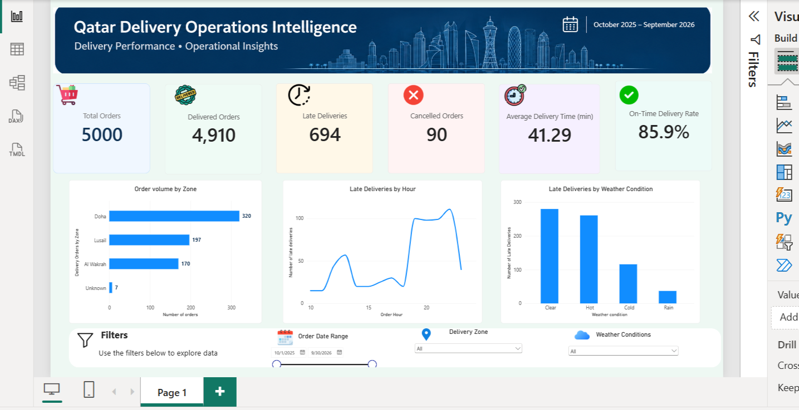

# Qatar Delivery Operations Intelligence

An end-to-end analytics project that combines **Power BI, Python, SQL-ready data workflows, Flask, and machine learning** to monitor delivery performance and estimate late-delivery risk.

> **Project note:** This portfolio project uses synthetic delivery data. It is not affiliated with, or based on confidential data from, Snoonu or Talabat.

## Live Demo

- **Flask Application:** https://qatar-delivery-operations-intelligence.onrender.com/
- **GitHub Repository:** https://github.com/Amoskipkirui/Qatar-Delivery-Operations-Intelligence

## Business Problem

Delivery businesses need to monitor order volumes, cancellations, delivery delays, and service reliability. This project demonstrates how operational data can be transformed into management dashboards and predictive insights to support better delivery decisions.

## Power BI Dashboard

The Power BI dashboard provides an overview of delivery operations through key performance indicators and visual analysis.

### Key Performance Indicators

- Total orders
- Delivered orders
- Cancelled orders
- Late deliveries
- On-time delivery rate
- Average delivery time

### Dashboard Screenshots

Add your dashboard screenshots to the `screenshots/` folder. Replace the example filenames below with the exact names of your saved images.



*Power BI dashboard showing delivery performance KPIs and operational trends.*

## Machine Learning and Flask Application

The project includes a machine-learning model that estimates the likelihood of an order being delivered late.

The Flask application provides:
- An interface for entering delivery and operational details.
- A late-delivery prediction and risk category.
- A prediction API for programmatic access.
- Dashboard KPIs calculated from the cleaned dataset.

### Model Inputs

The model uses features such as:
- Delivery zone and order type
- Delivery distance
- Traffic and weather conditions
- Preparation time
- Courier experience
- Promised delivery time
- Order hour, day of week, and month

The model is a decision-support prototype, not a guarantee of actual delivery outcomes.

## Technology Stack

| Area | Tools |
|---|---|
| Business intelligence | Power BI, DAX |
| Data preparation | Python, Pandas, NumPy |
| Machine learning | Scikit-learn |
| Application | Flask, HTML, CSS |
| Version control | Git, GitHub |
| Deployment | Render |

## Dataset

The project uses a synthetic dataset of 5,020 delivery-order records. The data includes order timing, delivery zone, distance, traffic, weather, preparation time, courier experience, promised and actual delivery times, and order status.

The dataset supports demonstration and learning; results should not be interpreted as real-world Snoonu or Talabat performance.

## Project Structure

```text
Qatar-Delivery-Operations-Intelligence/
├── data/
├── models/
├── notebooks/
├── powerbi/
│   └── Delivery_Operations_Dashboard.pbix
├── screenshots/
├── static/
├── templates/
├── app.py
├── clean_delivery_data.py
├── train_model.py
├── requirements.txt
└── README.md
```

## Run Locally

1. Clone the repository:

   ```bash
   git clone https://github.com/Amoskipkirui/Qatar-Delivery-Operations-Intelligence.git
   cd Qatar-Delivery-Operations-Intelligence
   ```

2. Create and activate a virtual environment.

3. Install dependencies:

   ```bash
   pip install -r requirements.txt
   ```

4. Ensure the cleaned dataset and trained model are available in `data/` and `models/`.

5. Start the application:

   ```bash
   python app.py
   ```

6. Open `http://127.0.0.1:5000` in your browser.

## Business Value

This project demonstrates how a delivery operations team could:
- Monitor service performance using clear KPIs.
- Identify patterns associated with late deliveries.
- Flag potentially high-risk orders for operational review.
- Combine descriptive analytics with predictive decision support.

The project illustrates a possible workflow; actual financial or operational improvements would need to be validated using real business data.

## Limitations and Future Improvements

- Replace synthetic data with authorised operational data.
- Automate ingestion and refresh of new delivery records.
- Connect a persistent data source to the deployed application.
- Publish the Power BI report with appropriate access controls.
- Monitor model performance and retrain when sufficient new labelled data becomes available.

## Author

**Amos Kipkirui**  
Data Analyst | Business Intelligence | Machine Learning

- [GitHub Portfolio](https://github.com/Amoskipkirui)
- [LinkedIn](https://www.linkedin.com/in/emoh-kipkirui-a7167a263/)
- [Live Flask Demo](https://qatar-delivery-operations-intelligence.onrender.com/)
